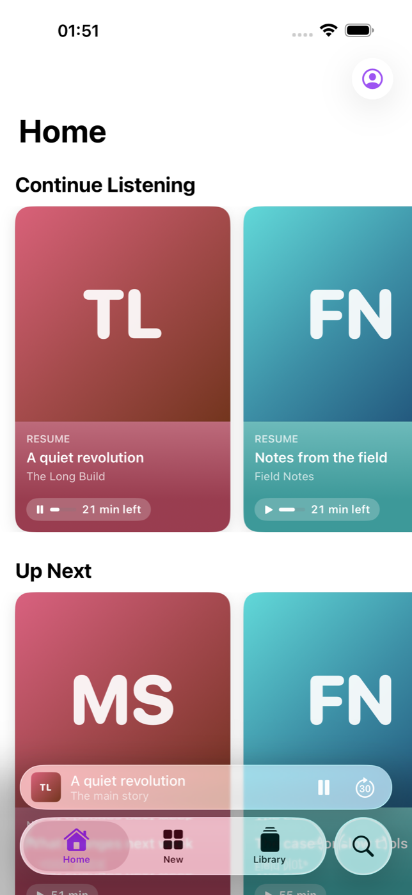
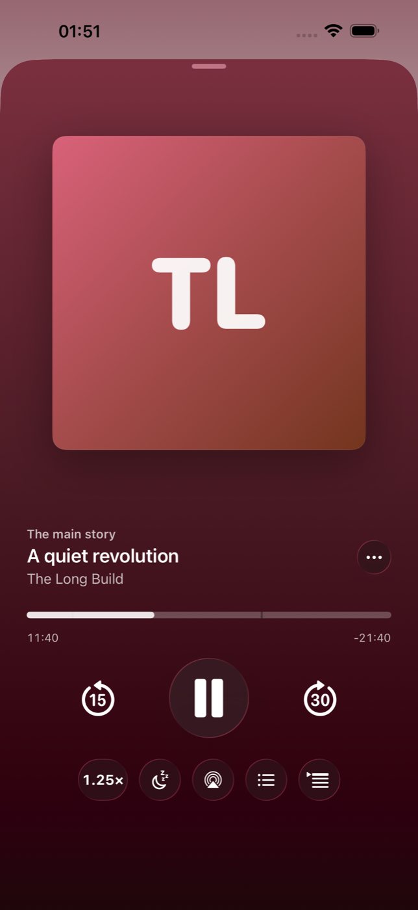
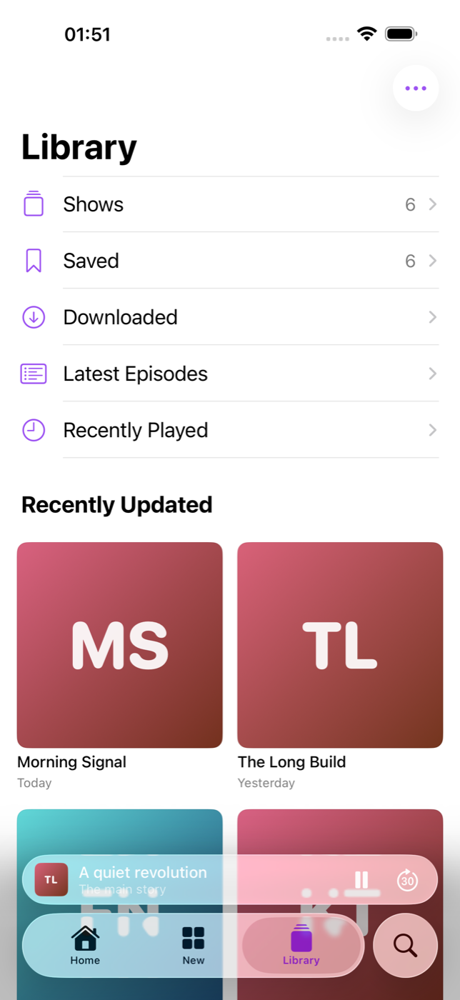
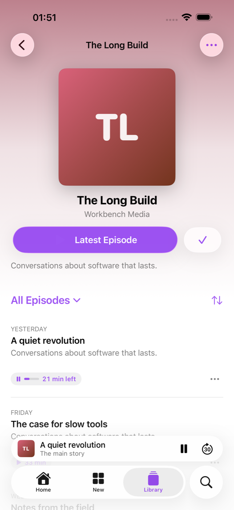
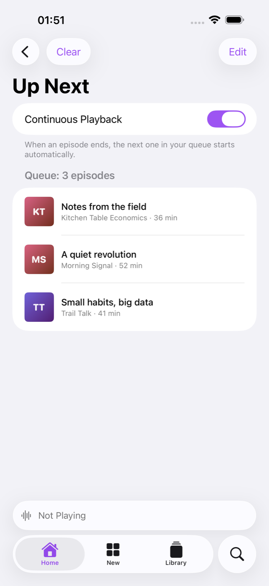

# HomeCast

**A native iOS podcast app for your own [PinePods](https://github.com/madeofpendletonwool/PinePods) server – the look and feel of Apple Podcasts, without iCloud.**

HomeCast is an independent iPhone client that keeps your subscriptions, playback positions, played/saved state and your *Up Next* queue in sync through a self-hosted PinePods server. It aims to feel like Apple's Podcasts app on iOS 26 (Liquid Glass tab bar, mini player, Now Playing card, Up Next …) while your listening data stays on hardware you own.

> **Status:** first release, tested in the iOS 26 simulator against PinePods **0.9.2**. UI in **English and German** (follows the iPhone language). Code comments are in German.
>
> Built with help from [Claude Code](https://claude.com/claude-code): Apple's Podcasts frameworks were analysed by name and strings only (no decompilation), the design decisions are mine, a lot of the Swift was written together with it.
>
> **Personal project:** no guarantees, no support promises. Bug reports and pull requests are welcome.
>
> Not affiliated with Apple or with PinePods. "Apple Podcasts" is a trademark of Apple Inc.

<p align="center">
  
  
  
  
  
</p>
<p align="center"><sub>Screenshots with made-up demo shows (generated cover art).</sub></p>

## Features

**Home**
- *Continue Listening* (episodes in progress, from any of your devices), *Up Next* (newest unplayed episode of each show), your queue, your shows, new episodes
- Remove items from *Up Next*, pull to refresh

**New / Discover**
- Top shows and trending episodes from Apple's public chart feeds (for your region)
- Browse categories (top shows per genre)

**Search**
- Shows and episodes via the public iTunes Search API, top result, recent searches
- Scope *Library*: search your own shows and episodes
- Play episodes straight from search results, open any show as a preview before following it

**Library**
- Shows (grid or list, sort by date updated, title or date followed), Saved, Downloaded, Latest Episodes, Recently Played, Recently Updated
- Follow a show by RSS URL

**Show page**
- Header in the cover's colours, Follow/Unfollow, *Latest Episode* (or *First Episode* for serial shows)
- Filter (all, unplayed, played, saved, downloaded), newest/oldest first, hide played, mark all played/unplayed, remove all downloads, share, copy link
- Paged episode list, show info (provider, category, episode count, last update, website)

**Episode page**
- Show notes with tappable links and **timestamps** (tap 12:34 to play from there)
- Play/Resume with remaining time, Save, Download, Play Next / Play Last, mark played, share, copy link
- Context menus and swipe actions everywhere, with Apple's wording

**Player**
- Mini player as iOS 26 tab bar accessory, full-screen *Now Playing* with Liquid Glass controls
- Speed 0.5×–3× (time-domain pitch correction), **per show** or as default – stored on the server
- Skip back/forward (10/15/30/45/60 s), scrubbing with fine control (drag down while scrubbing)
- **Sleep timer**: minutes (with fade-out), end of episode, end of chapter
- **Chapters** (Podcasting 2.0 JSON via PinePods or the feed, ID3/MP4 chapters in the file) with list, chapter marks on the progress bar, next/previous chapter
- **Up Next queue**: reorder, remove, clear, continuous playback
- Background audio, Lock Screen / Control Center / Dynamic Island, headphone controls (skip or next/previous), AirPlay

**Sync & offline**
- Subscriptions, position (every 15 s, on pause, when switching episodes or leaving the app), played, saved and the queue are synced with PinePods
- Starts at the newer position (another device's position from the server unless this device has unsent progress)
- Works offline: library snapshot on the device, changes are queued and sent later
- **Downloads** for offline listening (background downloads, pause/resume/cancel), cellular rule (always / ask over 200 MB / always ask), *Download When Saving*, *Remove Played Downloads* after 24 h

## Requirements

- A PinePods server (tested with **0.9.2**) reachable from the iPhone – at home or via VPN (e.g. WireGuard). Setup: [docs/SETUP.md](docs/SETUP.md)
- Xcode 26, [XcodeGen](https://github.com/yonaskolb/XcodeGen) (`brew install xcodegen`)
- iPhone with iOS 26

## Install without a Mac

You need your own PinePods server for this. **Step-by-step guide from zero (server, access from outside, install): [docs/SETUP.md](docs/SETUP.md).**

1. Get `HomeCast.ipa` (from a release, or built with `./build-ipa.sh`).
2. Install it with [SideStore](https://sidestore.io) or [AltStore](https://altstore.io). A free Apple ID is enough, the app then has to be refreshed every 7 days (SideStore does that on the phone).
3. Open the app and sign in with your PinePods server address and your PinePods account.

## Build & install

```bash
git clone https://github.com/<you>/homecast.git
cd homecast
xcodegen generate
open HomeCast.xcodeproj
```

1. Set your own **bundle identifier** in `project.yml` (default: `org.homeroll.homecast`) and select your team in Xcode.
2. Run on your iPhone. Sign in with your PinePods server address (e.g. `https://podcasts.example.com` or `http://192.168.x.y:8040`) and your account.
3. Unsigned IPA for sideloading (AltStore/SideStore): `./build-ipa.sh`.

### Simulator with a test account

Create a git-ignored file `.test-account` in the project folder:

```bash
HOMECAST_SERVER=http://<server>:8040
HOMECAST_API_KEY=<pinepods-api-key>       # never commit this
```

```bash
xcrun simctl create "HomeCast Test" "iPhone 17 Pro Max"
./sim-run.sh                      # signed in with the API key, no typing
HOMECAST_DEMO=1 ./sim-run.sh      # made-up demo data, no server needed
```

Debug builds only: `HOMECAST_SERVER` + `HOMECAST_API_KEY` sign in at launch, `HOMECAST_DEMO=1` shows demo data, `HOMECAST_RESET=1` clears the local state.

### Tests

```bash
TEST_RUNNER_PODCAST_SERVER=http://<server>:8040 TEST_RUNNER_PODCAST_API_KEY=<key> \
TEST_RUNNER_PODCAST_USER=<user> TEST_RUNNER_PODCAST_PASSWORD=<password> \
xcodebuild test -project HomeCast.xcodeproj -scheme HomeCast -destination 'platform=iOS Simulator,name=HomeCast Test'
```

- `HomeCastTests`: API client against a real PinePods test account (login, shows, paging, position, played, saved, queue add/reorder/bump/remove/clear, follow/unfollow, chapters, per-show speed, offline queue + flush), plus feed parser, chapters JSON, show notes and time formats.
- `HomeCastUITests`: main flow in the simulator (library → show → play → mini player → Now Playing with speed, sleep timer and queue → home → charts → search), episode actions, and the README screenshots (`SCREENSHOT_DIR=…`, demo data).

Translations: `python3 tools/gen-strings.py` rebuilds `Resources/Localizable.xcstrings` from the keys the compiler extracted and `tools/translations.json` (fails if a translation is missing). App icon: `swift tools/make-icon.swift Resources/Assets.xcassets/AppIcon.appiconset`.

## Privacy

- The app talks to **your PinePods server**, to the podcasts' own servers (feeds, audio, cover art – just like any podcast app) and to Apple's public iTunes Search API and chart feeds for search and discovery (no account, no personal data, only the search term and your region).
- No analytics, no third-party SDKs.
- The API key is stored in the Keychain. Your password is only used once to get the key and is not stored.

## Project layout

```
App/API/        PinePods client, iTunes search/charts, RSS + chapters parser
App/Sync/       library store: server sync, offline snapshot, pending-changes queue
App/Player/     AVPlayer core, sleep timer, chapters, Now Playing / remote commands
App/Downloads/  background downloads, network state
App/UI/         SwiftUI screens (Home, Discover, Search, Library, Show, Episode, Player, Settings, Login)
Tests/          unit tests (API against a test account, parsers)
UITests/        UI tests and screenshot run
tools/          icon generator, string catalog generator
```

## License

[MIT](LICENSE). Third-party: PinePods (GPL-3.0) is not included – HomeCast only talks to its HTTP API.

---

## Deutsch

**HomeCast** ist eine eigene iPhone-Podcast-App für deinen selbst betriebenen PinePods-Server. Sie sieht aus und fühlt sich an wie Apples Podcasts-App unter iOS 26; Abos, Wiedergabestand, gesicherte Folgen und die Warteliste werden über deinen eigenen Server abgeglichen, ohne iCloud. Die Oberfläche gibt es auf Deutsch und Englisch, je nach Sprache des iPhones. Funktionen, Voraussetzungen und Installation stehen oben.
